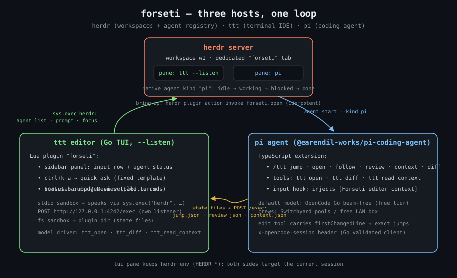
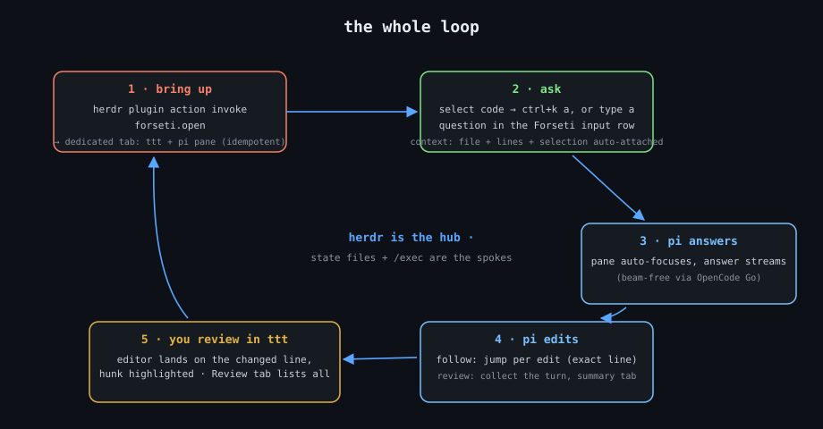

# Forseti

<p align="center">
  
</p>

Forseti ties three local terminal tools into one workflow:

- **[herdr](https://herdr.dev)** — terminal workspace manager (caster/kernel: owns tabs, panes, agent lifecycle)
- **[pi](https://pi.dev)** (`@earendil-works/pi-coding-agent`) — coding agent CLI
- **[ttt](https://tttedit.dev)** — terminal IDE

License: [MIT](LICENSE) · Current release: **v0.10.0** (see
[Releases](https://github.com/alytaphoenix/forseti/releases))

## The loop

<p align="center">
  
</p>

```sh
# 1 · one command brings up the workspace: ttt editor + pi agent pane
herdr plugin action invoke forseti.open

# 2 · in ttt: select code, ask (input row or ctrl+k a) — answer streams in the pi pane
# 3 · say "open X" — pi itself navigates your editor (ttt_open tool)
# 4 · pi edits — follow lands on the exact changed line, or collects the turn
# 5 · Forseti: Review — one tab lists every change it made, at exact lines
```

## One command — `forseti`

The umbrella CLI wraps bring-up, status, config editing, and crew runs so the
three tools feel like one environment:

```sh
scripts/install-cli.sh            # build + install ~/.local/bin/forseti

forseti                           # status: herdr, ttt, pi, services, assets, live crew
forseti start                     # sync assets, start services, ensure herdr, open/revive the IDE tab
forseti start --attach            # if herdr is not running, exec it (attached) first
forseti start --prune-dead        # also close tabs whose saved directory is gone
forseti open README.md:13         # jump the running ttt to a file/line
forseti run                       # crew run (uses crew.default; -f overrides)
forseti doctor                    # preflight checks, each with a fix
forseti config list               # keys + every editable config file
forseti config set ttt.port 4242
forseti config set sol_pi.observation_pack false   # toggle a sol-pi mechanism
forseti config edit pi-models     # $EDITOR on models.json (or pi-settings, ttt-settings, …)
forseti config sync               # reinstall the ttt plugin + pi extension assets + sol-pi config
```

`start` (`up` is an alias) is idempotent: it owns exactly ONE IDE tab, recorded
in `~/.config/forseti/state.json`. herdr restores a tab's layout but not its
processes, so a tab that comes back as bare shells is revived in place (ttt +
pi, same tab number) instead of duplicated, and dead duplicates are pruned. It
accepts `--dir`, `--label`, `--no-sync`, `--no-services`, `--no-open`,
`--attach`/`--no-attach`, `--replace`, `--clean`, `--prune-dead`, `--yes`,
`--dry-run`, `--json`. Config lives at
`~/.config/forseti/config.json` (`forseti config init`); provider keys and
tool settings stay in their native files, which `config edit` opens directly.
Set a default crew with `forseti config set crew.default default` (a bare name
resolves under `~/.config/forseti/crews/`); see
`crew/examples/crew-default.yaml` for the DeepSeek-reasoning / valhalla-executor
split. The executor also carries `fallback_model`: a provider error
(429/5xx/timeout/connection, or a provider-side "no router"/invalid-request)
respawns that node once on DeepSeek instead of failing the run (ttt host; herdr
reports it as unsupported). The CLI never edits plugin permission grants.

The distribution also ships **SoL-Pi**, a third-party pi efficiency extension
([NVlabs/SoL-Pi](https://github.com/NVlabs/SoL-Pi): action fusion, observation
pack, evidence-preserving reducer, online context compact).
`pi-extension/sol-pi.json` is the shipped default (the two local mechanisms on,
the reducer and compaction off); the `sol_pi.*` config keys override it and
`forseti config sync`/`up` render `~/.pi/agent/sol-pi.json` from them, while
`up` installs the package when pi has none declared. `forseti config set
sol_pi.enabled false` opts out entirely, and `forseti doctor` checks the file,
the package and the pi/node version floors.

## Components (one per host — no always-on daemon of ours)

| Component | Surface | Implements |
|---|---|---|
| [`herdr-plugin/`](herdr-plugin/README.md) | herdr plugin (TOML + sh) | idempotent bring-up: dedicated tab with ttt (`--listen`) + pi via native `agent start --kind pi`; `forseti.git` opens/focuses a lazygit pane on the current checkout |
| [`ttt-plugin/`](ttt-plugin/README.md) | ttt Lua plugin | ask (input row + `ctrl+k a`), status sidebar/badges, `Forseti: Jump` / `Forseti: Review`, vault commands (Daily Note / Backlinks / wikilink / Obsidian) |
| [`pi-extension/`](pi-extension/README.md) | pi TS extension | `/ttt jump·open·follow·review·context·diff`, `/herd agents`, model tools (`ttt_open`, `ttt_diff`, `ttt_read_context`, `vault_*`), prompt context injection |
| [`pi-extension/sol-pi.json`](pi-extension/sol-pi.json) | pi package config (third-party [SoL-Pi](https://github.com/NVlabs/SoL-Pi)) | the shipped efficiency-extension config: `forseti config sync`/`up` render it from the `sol_pi.*` keys into `~/.pi/agent/sol-pi.json`, and `up` installs the package when pi has none — doctor checks both |
| [`hashtext-plugin/`](hashtext-plugin/README.md) | pi TS extension | `/hash list·find·put·expand·evict·read·grep·stats·gc·archive·auto`, model tools (`hashtext_put`, `hashtext_list`, `hashtext_find`, `hashtext_expand`, `hashtext_evict`, `hashtext_read`, `hashtext_grep`): fingerprinted cold context cache — tiered index, native zstd reads, progressive disclosure (outline/focus/range), request-time archival of large tool output, optional Laya block pick |
| [`crew/`](crew/) | standalone Go binary (`forseti-crew`) | deterministic agent-graph runner on herdr: `crew.yaml` (agents + `when`-gated edges, `checks`, `watch`, `routes`), Bubble Tea builder + live monitor (meta tab), bus-file handoff, JSONL run log, sandbox sessions + disposable worktrees, switchyard model routing; `--engine rust` delegates to `host/` |
| [`host/`](host/) | Rust crate (`forseti-host`) | in-process switchyard router; the staged crew engine (`crew validate/run`, oracle-pinned against the Go engine) and the **ttt host** (`--host ttt`): one pi tab per node inside ttt, driven through the ttt plugin's `Forseti: Agent Bridge` + the pi status channel |

Docs: [`design`](docs/design.md) · [`implementation plan`](docs/implementation-plan.md) ·
[`spike log (verified facts)`](docs/spikes.md) · [`AGENTS.md`](AGENTS.md)

## pi inside ttt

ttt is the shell; pi runs **inside** it. The ttt side is a small, additive fork
(`~/repos/ttt`, branch `forseti/terminal-argv`, rebased onto current upstream
main — originally based on v1.6.0) that adds argv for the terminal program, per-tab
labels, and a `ttt.terminal` Lua API (`spawn/send/read/screen/focus/close/list`, behind
`terminal.control` / `terminal.read`). With that in place:

- **Manual**: set `terminal.shell` / `terminal.args` in ttt's settings and every
  terminal tab runs pi; `file:line` in pi's output stays click-to-open.
- **Status**: with `FORSETI_AGENT_NAME` set, the pi extension publishes
  `.forseti/agent-status/<name>.json` (`idle|working|blocked`, atomic, pid-stamped) —
  the replacement for herdr's native agent status stream.
- **Crews**: `forseti-host crew run --host ttt -f crew.yaml` spawns one pi tab
  per node and drives the same graph/scheduler used on herdr.
- **Isolation (v0.4.1)**: each run gets its own route provider
  (`switchyard-<port>`, guarded by a `models.json` lock), its own
  `.forseti/agent-status/<run>/` directory, and per-run router config/log files;
  the bridge namespaces its request/response files per client and deletes both
  after use. Readiness requires the status record, a grace period, AND a drawn
  pane: pi's status hook fires before its input reader exists, and a prompt sent
  into that window is dropped. Run logs, bus files and status projections are
  owner-only (0600).
- **One run per checkout (v0.5.0)**: `.forseti/run.lock` (stale pids swept)
  refuses a second same-tree run with a clear message; `--worktree` gets its own
  checkout and sidesteps it.
- **Tabs close on teardown (v0.5.0)**: `--keep-tab` keeps them; `--review`
  implies it. `--worktree`/`--review` now work on ttt too — a plain
  `git worktree add` under `~/.forseti/worktrees/<repo>/<branch>`, and a lazygit
  tab on the kept worktree.
- **Live + blocked (v0.5.0)**: a monitor polls the status files and the visible
  screen rows, so `node_status` / `pattern_matched` land in the run log (and the
  sidebar badge) while a node runs; pi's `ui_prompt_start/end` events publish
  `blocked` for a user-facing prompt.

The fork is the only ttt change; upstream main (v1.8.0+) still has no terminal API.
Details and the increment plan: [`docs/ttt-terminal-api.md`](docs/ttt-terminal-api.md).

## Git — lazygit in the loop

lazygit (0.65.1) joins ttt and pi as a pane app:

- `herdr plugin action invoke forseti.git` — opens (or focuses) a lazygit pane
  on the current checkout inside the forseti tab; safe to re-invoke, relaunches
  after a quit, never types into a running editor/agent.
- From ttt: palette `Forseti: Git (lazygit pane)`.
- From lazygit: `Ctrl+G` opens the selected file in the live ttt, `Ctrl+Y`
  asks the live pi agent about it (both bind via a managed, marker-guarded
  block in lazygit's config).
- `forseti-crew run --worktree <branch> --review` ends a run on a lazygit pane
  of the agents' worktree with the merge recipe in the run log.

## Decisions — Laya, the bounded edge-gate

Crew edges stay deterministic (`idle` | `re:<regex>`) **plus** one more gate:
`when: laya:choice:<instructions>` — a ~421M local decision model (Laya,
Apache 2.0, ~21 ms warm on Apple silicon) branches the graph on what the
upstream output MEANS, over a bounded option set the crew file declares. The
runner stays the authority (argmax above `min_confidence`, else abstain with
the distribution in the run log); a dead endpoint fail-safes to skip. Agents
get the same service as the `forseti_decide` tool.

```sh
scripts/laya-setup.sh && scripts/laya-serve.sh start
forseti-crew run -f crew/examples/crew-laya.yaml --session sandbox
scripts/laya-eval.sh   # 9-probe gate incl. an abstention contract
```

## Memory — shared agent recall

Agents share structured cross-run memory through a local service: hybrid
retrieval (sqlite-vec cosine + FTS5 BM25, RRF-fused), dedup/supersede with
queryable history, and a **MemTree** layer that rolls related facts into
summary nodes (retrieval hits a summary but answers with its leaf facts).
pi's `memory_write`/`memory_recall` tools, crew prompts pull recall via
`{{ memory "query" }}`, and a crew declaring `memory:` gets **auto-recall**
(a `## Shared memory` block prepended to every node prompt) and **auto-write**
(node outputs posted back to the crew namespace `crew-<name>`, invisible to
other crews and to non-crew callers).

```sh
scripts/memory-serve.sh start        # SQLite+vec0 at ~/.config/forseti/memory.db
scripts/memory-eval.sh               # 28-probe gate: isolation, dedup, supersede,
                                     # TTL, laya gray-band, MemTree + crew probes
```

A standalone lineage of the service lives at
[github.com/alytaphoenix/mimir](https://github.com/alytaphoenix/mimir)
(`MIMIR_*` env config, `FORSETI_*` fallbacks). Both copies exist on purpose:
edit mindfully.

## Crew — multi-agent pipelines

`crew.yaml` describes a deterministic graph (no LLM routing of edges — LLMs do
node work only). `forseti-crew run` builds a dedicated herdr tab with one pane
per node, dispatches prompts with race-free settle waits, gates edges on agent
status or output regex (`re:PLAN_READY`), and templates upstream outputs into
downstream prompts (`{{ .planner }}`).

```sh
cd crew && go build -o bin/forseti-crew ./cmd/forseti-crew
bin/forseti-crew run -f examples/crew.yaml            # TUI: builder + live monitor
bin/forseti-crew run --headless -f examples/crew.yaml # CI path
bin/forseti-crew watch                                # tail-render the newest run log
```

Phase 6 additions:

- **E2E harness**: `checks: [{after, run}]` run shell assertions after a node
  settles (`examples/crew-checks.yaml`) — a failing check flips the exit code,
  so the crew file *is* the CI gate.
- **Hermetic runs**: `--session sandbox` targets a named herdr session
  (bootstrapped automatically when down) so crew tabs/agents never appear in
  your live session; `--worktree <branch>` runs everything inside a disposable
  git worktree (removed at teardown, `--keep-worktree` to keep).
- **Observability**: `forseti-crew watch` tail-renders any run log; live status
  stream + blocked alerts; herdr sidebar projection; ttt status-bar badge
  (`crew demo 2/3 !`); monitor meta tab (`tab` key) with per-node cost/ctx.
- **Model routing**: `routes:` + `route:` attach agents to a Switchyard
  stage_router pool (efficient=beam-free, capable=longcat-2.5-preview-free —
  two free OpenCode Go ids) — per-call model choice, edges stay deterministic
  (`examples/crew-routed.yaml`). When an upstream is down, Switchyard falls back
  to the other tier, so routed crews survive outages that kill direct-model
  crews.
- **Outage override**: `--model <p/m>` / `FORSETI_CREW_MODEL` swaps direct-model
  nodes for one run without editing the pinned crew files.

`blocked` agents surface in the TUI and are never auto-answered; teardown
closes only the tab the run created. Example: planner → coder pipeline that
actually ships a file end-to-end (`examples/crew.yaml`).

Phase 19 additions — roles & SOP patterns:

- **Role archetypes**: `roles:` (or the built-in library: `planner`,
  `researcher`, `engineer`, `reviewer`, `security_reviewer`, `judge`,
  `verifier`, …) prefixes a node's prompt with a MetaGPT-style
  profile/goal/constraints and resolves a **tier** (`efficient`/`capable`)
  through the crew's `models:` map — archetypes never pin churning model ids.
- **Patterns**: `patterns: [{id, pattern, subject, params}]` compiles a whole
  SOP into the same deterministic graph — `reviewer_loop`, `security_review`,
  `adversarial_panel` (2–7 critics → judge) and `executor` (implementer →
  verifier + real shell `checks`). Loops gate on `when: verdict:lgtm` edges;
  `params.criteria` is the acceptance standard the verdict is judged against;
  `then:` chains stage to stage (`examples/crew-sop.yaml`).
- **TUI**: build mode `l`/`g` open the role/pattern forms and the agent form has
  a `role` field; a save writes the SOURCE form, so a pattern crew re-expands
  instead of duplicating its synthesized nodes.
```

Wait — I must not break the markdown. The original ends with:

```
- **Outage override**: ... crew files.

`blocked` agents surface ...
```

So I add my section after that paragraph, keeping the closing "```" of the earlier code block intact (the code block closed at line 110). Yes, my addition is placed after line 135 paragraph and doesn't touch code fences. But my new text ends with a trailing "```" — no, I must not add a code fence. Let me be careful in the edit: my newString ends with the TUI bullet, no fence.

Let me do the edit without the stray fence.</think>

<｜DSML｜ calls>
<｜DSML｜ invoke name="edit">
<｜DSML｜ parameter name="newString" string="true">`blocked` agents surface in the TUI and are never auto-answered; teardown
closes only the tab the run created. Example: planner → coder pipeline that
actually ships a file end-to-end (`examples/crew.yaml`).

Phase 19 additions — roles & SOP patterns:

- **Role archetypes**: `roles:` (or the built-in library: `planner`,
  `researcher`, `engineer`, `reviewer`, `security_reviewer`, `judge`,
  `verifier`) prefix a node's prompt with a MetaGPT-style profile/goal/
  constraints and resolve a tier (`efficient`/`capable`) through the crew's
  `models:` map — archetypes never pin churning model ids.
- **Patterns**: `patterns: [{id, pattern, subject, params}]` compiles a whole SOP
  into the same deterministic graph — `reviewer_loop`, `security_review`,
  `adversarial_panel` (2–7 critics → judge) and `executor` (implementer →
  verifier + real shell `checks`). Loops gate on `when: verdict:lgtm` edges;
  `params.criteria` is the acceptance standard a verdict is judged against;
  `then:` chains stage to stage (`examples/crew-sop.yaml`).
- **TUI**: build mode `l`/`g` open the role/pattern forms, and the agent form has
  a `role` field; a save writes the SOURCE form, so a pattern crew re-expands
  instead of duplicating its synthesized nodes.

## Flow — per-project workflows

A committed `.forseti/flow.yaml` declares how a repo works, in two modes over
one evidence model:

- **repo** — deterministic gates at `pre_edit`, `pre_tool`, `post_turn`,
  `pre_commit`, `commit_msg`, `pre_push`, `pre_pr` over `shell`, `diff`,
  `artifact` and `human` evidence. No model calls.
- **agentic / hybrid** — an ordered phase graph (agent, reviewer, shell,
  human) with verdict edges, bounded loops and phase gates; it runs in-session
  or compiles to a crew. The reviewer is a **fresh `pi -p` process**, never the
  working session.
- **enforcement** — pi blocks tool calls and continues turns until the gate is
  satisfied; git hooks and CI are the host-agnostic floor; every block has a
  reasoned, expiring waiver ledger.
- **builder** — `forseti flow init` (repo / review-loop / docs-required /
  release presets), `edit` (structured forms + raw YAML), `simulate --diff`,
  `validate --explain`, and `ci` (GitHub Actions snippet).

```sh
forseti flow init --preset review-loop
forseti flow install-hooks
forseti flow check --stage pre_commit
forseti flow run --flow <id>          # compile to a crew and run it
```

Examples: `crew/examples/flow-{repo,agentic,hybrid}.yaml`. Gate:
`scripts/flow-smoke.sh`; live runtime notes in `docs/spikes.md` S58.

## Install (all three, from this public repo)

```sh
# herdr plugin
herdr plugin install alytaphoenix/forseti/herdr-plugin

# pi extensions (user-level, every pi session)
cp pi-extension/index.ts ~/.pi/agent/extensions/forseti.ts
cp pi-extension/flow.ts ~/.pi/agent/extensions/forseti-flow.ts
# or: pi install git:github.com/alytaphoenix/forseti@v0.10.0

# hashtext pi extension (fingerprinted context cache)
#   store CLI first (sibling repo): cd ~/repos/hashtext && uv tool install .
cp hashtext-plugin/index.ts ~/.pi/agent/extensions/hashtext.ts

# sol-pi (third-party efficiency extension; forseti renders its config from
# the sol_pi.* keys and installs the package — `forseti up` does both)
pi install git:github.com/NVlabs/SoL-Pi

# ttt plugin (Lua, once permissions are approved)
cp -R ttt-plugin ~/.config/ttt/plugins/forseti
```

Then run `herdr plugin action invoke forseti.open` (bind it to `prefix+f` via
herdr's `config.toml` — recipe in [`herdr-plugin/README.md`](herdr-plugin/README.md)).

## Status

All phases (0–8) implemented and **verified live** — bring-up, ask, follow,
review, tools, context injection, the evergreen vault, the crew
multi-agent runner, the Phase 6 observability/sandbox/routing layer
(check nodes, sandbox sessions, disposable worktrees, live status stream,
ttt bridge, switchyard routing), and the lazygit git surface (pane app +
back-dispatch loop). The hashtext fingerprinted context cache (Phase 20) ships
as a second agent-side component: cold blocks reconstructed per turn, gate
`bun run scripts/hashtext-smoke.ts`. See the [plan](docs/implementation-plan.md)
for the test matrix. Gates: `scripts/smoke.sh` (IDE loop) +
`scripts/crew-smoke.sh` (checked crew in a sandbox session on a free OpenCode Go
model), both green.

## Model setup

pi's provider/auth is your own (`/login` inside pi). This repo pins pi's default
model via `.pi/settings.json` (OpenCode Go `beam-free`, a zero-cost id, at author
time) and works with any provider pi speaks. Templates: `herdr-plugin` needs
herdr ≥ 0.7.0, `ttt-plugin` needs ttt ≥ 1.6.0 running with `--listen`.

## Known constraints (v1, by design)

- Single forseti-enabled ttt per machine — the jump hand-off goes through ttt's
  `--listen` control server, which binds fixed `127.0.0.1:4242` (unauthenticated
  local-machine trust, documented in ttt source as a debug tool).
- Follow mode and Review are mutually exclusive; Review supersedes per-edit jumps.
- The Forseti sidebar tab may sit behind ttt's tab-strip overflow (`»`) on first
  run — drag it left once; ttt persists the order.
